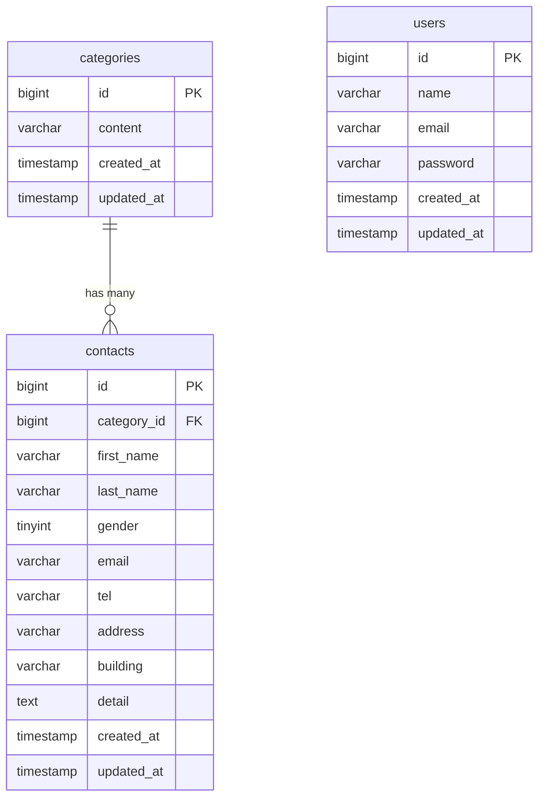

# COACHTECH お問い合わせフォーム

## 概要
お問い合わせの受付・管理を行うWebアプリケーション。

## 使用技術
- PHP 8.x / Laravel 10.x
- MySQL 8.0
- Nginx
- Docker / Laravel Sail

## ER図

## 環境構築手順
-リポジトリをクローン
git clone <リポジトリURL>
cd contact-form-app

-環境変数設定
cp .env.example .env

-コンテナを起動
./vendor/bin/sail up -d

-パッケージインストール
./vendor/bin/sail composer install
./vendor/bin/sail npm install
./vendor/bin/sail npm run build

-キー生成、マイグレーション
./vendor/bin/sail artisan key:generate
./vendor/bin/sail artisan migrate --seed

##APIエンドポイント一覧
GET / : お問い合わせ入力画面

POST /contacts/confirm : お問い合わせ確認画面

POST /contacts : お問い合わせ登録処理

GET /thanks : 完了画面

GET /login : ログイン画面

POST /login : ログイン処理

POST /logout : ログアウト処理

GET /register : 登録画面

POST /register : 登録処理

GET /admin : 管理画面（一覧・検索）

GET /admin/contacts/{id} : 詳細画面

DELETE /admin/contacts/{id} : 削除処理

GET /contacts/export : CSVエクスポート

## 開発環境URL
http://localhost

##　作成者
軒口　明也
